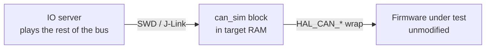
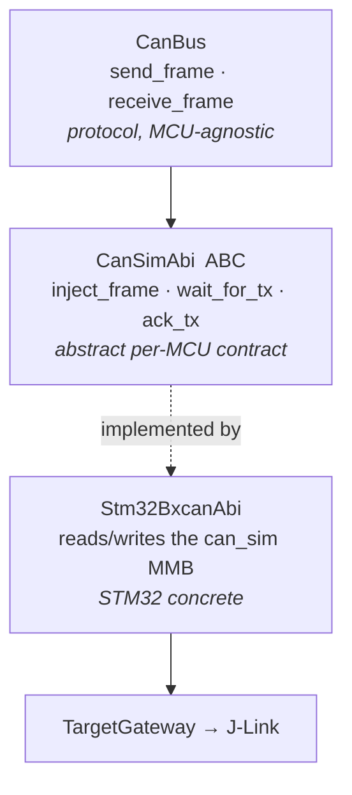
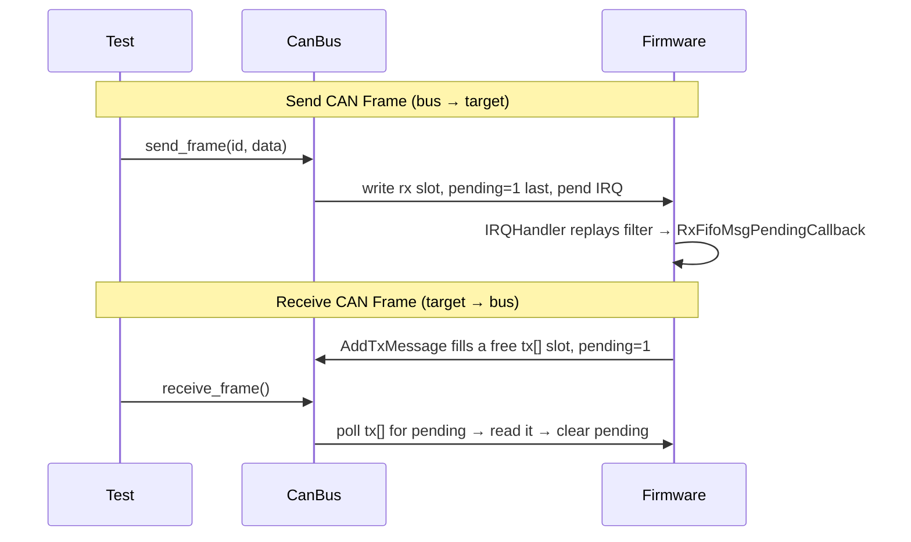

# CAN (bxCAN) simulation

The second peripheral built on the model in
[io-server-architecture.md](io-server-architecture.md): the IO server plays
**the rest of the CAN bus** for a target's bxCAN firmware, so it can be
tested without a second board, a transceiver, or a breadboard bus.

## The problem this replaces

Testing CAN firmware normally means putting a second node on the same
physical bus — another board, its own transceiver, wired together — just to
send it a frame and see what comes back. The IO server plays that other node
in software, talking to the board under test over SWD instead of wire:



One board. No second node. No transceiver. The application code never
changes — only the seven `HAL_CAN_*` calls it already makes get rerouted.

## The seam: `--wrap`, not register mocking

bxCAN's HAL has no board-porting layer to swap (unlike USB). So this plan
wraps the seven functions application code calls directly —
`HAL_CAN_Init/ConfigFilter/Start/ActivateNotification/AddTxMessage/
GetRxMessage` and the IRQ handler — with GNU ld's `-Wl,--wrap`. Every caller
still calls the same name; the linker redirects it to a simulation version
that moves data through RAM instead of silicon.

Repointing the `CAN1` registers themselves at the MMB (so the *unmodified*
vendor HAL runs against it) was considered and rejected — bxCAN's
init/start/stop calls poll a status bit with a hardcoded 10 ms timeout right
after requesting it, and a J-Link round trip can't reliably beat that clock.
See `todo.md` for when this approach might work for a different peripheral.

## Two layers, same split as USB



CAN has no Core/ClassDriver split like USB's — one bus, one frame shape, no
enumeration — so `CanBus` carries the whole protocol layer itself.

**Rule:** `peripherals/can/{abi,bus}.py` never imports
`peripherals/can/backends/*`. Enforced by
`tests/test_architecture_boundaries.py`, not just convention.

## The MMB: `CanSimBlock`

```text
CanSimBlock @ &can_sim            a .bss global; address read from the build's ELF
├── header (8 B)
│   magic version block_size      ← firmware publishes (validate handshake)
├── filters[N]                    ← firmware: one slot per HAL_CAN_ConfigFilter() bank
└── tx[3] + rx                    16 B frame slots: id ide rtr dlc pending data[8]
    tx[] ← firmware fills, server drains
    rx   ← server fills, firmware drains
```

Frame slots are **ID-agnostic** — the block has no notion of what any
particular frame ID means or which application role sent it. That meaning
lives entirely in the application firmware, which is what lets the same mock
serve any CAN firmware, not just one written for it.

Filters are stored, not reimplemented: `ConfigFilter_Sim` copies the exact
fields the app already computed, and the firmware's own IRQ handler replays
the same match arithmetic real silicon would — a wrong filter drops a frame
in simulation exactly like it would on the real bus.

## How a frame flows



**Ordering rule:** `pending` is always written last, on both sides. It is the
flag the other side polls, so writing it early hands over a half-written
frame. This is CAN's version of USB's DONE-last rule.

## From a suite

```robotframework
*** Settings ***
Library    engine.keywords.can_keywords.CanKeywords

*** Test Cases ***
Frame Round Trip
    Send CAN Frame    0x100    ${{ b'\x01\x02' }}
    ${frame}=    Receive CAN Frame
    Should Be Equal As Integers    ${frame.id}    0x100
```

Full keyword reference: [docs/api/README.md](../api/README.md#can-bxcan).

## Package shape

```text
firmware_abi/can/stm32_bxcan.py     # CanSimBlock offsets, magic, symbol name
peripherals/can/
  abi.py                            # CanFrame, CanSimAbi (ABC)
  bus.py                            # CanBus
  backends/stm32_bxcan.py           # Stm32BxcanAbi (concrete)
engine/keywords/can_keywords.py     # Send/Receive CAN Frame
tests/
  can/...                           # unit tests, fake gateway, no hardware
  hardware/can/...                  # opt-in J-Link test (WCET_CAN_TEST=1)
```

## Rules specific to this peripheral

- Only `CAN_FILTERMODE_IDMASK` at `CAN_FILTERSCALE_32BIT` is modelled. A bank
  configured any other way never matches — revisit if a scenario needs one.
- 3 tx mailboxes, 1 rx slot — matches real bxCAN's mailbox count, so "no
  mailbox free" behaves the same in both builds.
- Extended (29-bit) IDs and remote frames are represented in `CanFrame` but
  not yet exercised by any test.
