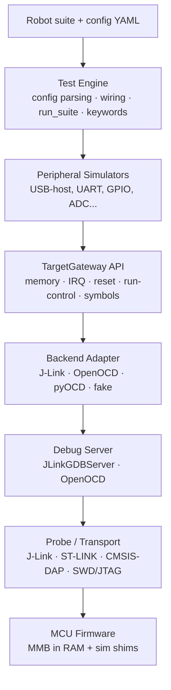
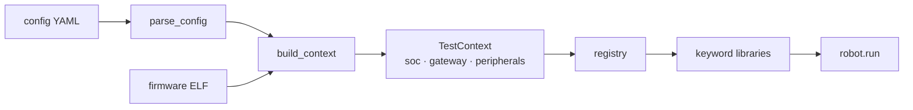
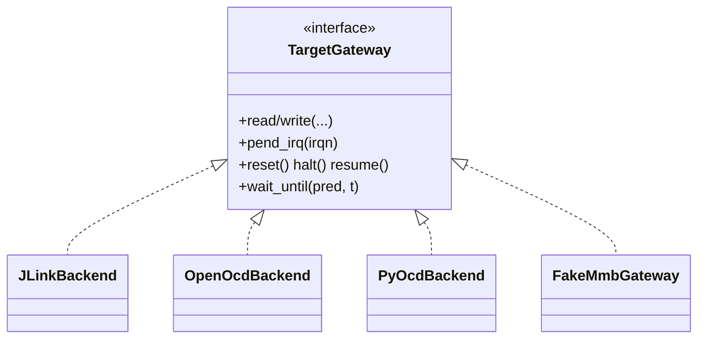
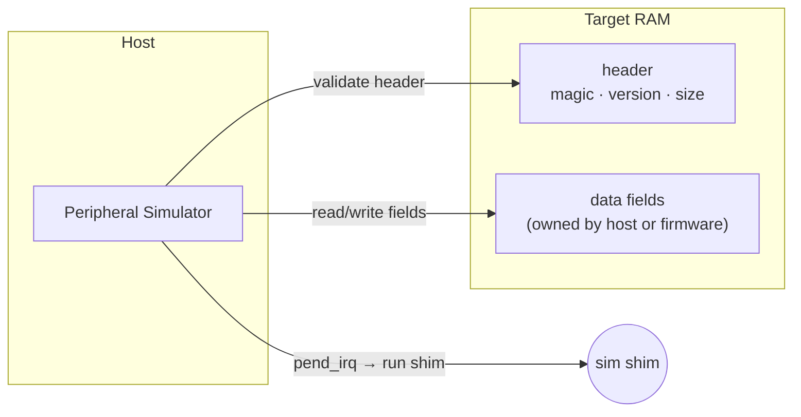

# IO Server Architecture

The IO server lets a host (tests, scenarios) **mock an MCU peripheral without the
real hardware on the other end**. The firmware runs unchanged except for thin
simulation shims that move data through a small RAM block (the *Mocking Memory
Block*, MMB) instead of a physical bus. The host drives that block over a debug
probe.

Two ideas keep this reusable across peripherals and probes:

- **Peripheral simulators express intent** — "inject a SETUP packet", "set GPIO 3 high".
- **Backends express mechanics** — "write target memory", "pend an IRQ", "reset".

Neither knows about the other: a USB simulator never learns whether the session
runs over J-Link or OpenOCD, and a backend never learns what a SETUP packet is.

## The documents

This file covers the parts every peripheral shares: the layer model, the
`TargetGateway` contract, the backends, and the MMB conventions. One file per
simulated peripheral covers the rest.

| Document | Covers |
| --- | --- |
| this file | Layers, gateway, backends, engine, MMB conventions |
| [usb-host-simulation.md](usb-host-simulation.md) | USB-host mode: mocking a CDC-ACM device for the target's USB host stack |
| [can-bxcan-simulation.md](can-bxcan-simulation.md) | CAN (bxCAN): mocking the can bus |

A new peripheral gets its own file here, following the USB one's shape: what it
simulates, its MMB layout, how a transfer flows, and the rules specific to it.

## Layer model



The load-bearing boundary is **Peripheral ↔ TargetGateway**. Everything above it
is portable; everything below it is probe-specific.

| Layer | Owns | Must not know |
| --- | --- | --- |
| Test engine | Config → objects, suite lifetime, keywords | MMB field meanings |
| Peripheral simulator | Peripheral protocol → MMB reads/writes | Debug-server protocol |
| TargetGateway | Stable target ops: memory, IRQ, reset, halt/resume, symbols | Peripheral meaning |
| Backend adapter | One access mechanism behind the gateway | Test semantics |
| Firmware ABI (MMB) | Versioned RAM block + event contract | Host backend |

## The test engine

A run is described by two inputs and one call. The suite says *what* to do, the
config says *what hardware to do it against*, and `run_suite()` connects the two:

```python
run_suite(suite.robot, config.yaml, outdir="results", elf=firmware.elf)
```

There is no CLI; `run_suite()` is the entry point, and it returns a `RunResult`
carrying the return code, pass/fail counts, and the paths of Robot's
`output.xml` / `log.html` / `report.html`.



- **`config_parser`** validates the YAML into the `config_schema` dataclasses,
  rejecting anything it does not understand rather than ignoring it.
- **`build_context`** resolves the MMB address, builds the gateway
  (`backend_factory`) and the mocks (`peripheral_factory`), and returns a
  `TestContext`.
- **`registry`** is a process-wide slot holding that context for the length of
  one run. Robot constructs keyword libraries with no arguments, so a library
  looks its peripheral up here instead of being handed one.
- **`run_suite`** owns the connection: `with context.gateway:` wraps the run, so
  nothing above or below it opens or closes the target.

Keywords live in `engine/keywords/`, one library per device class plus
`CoreKeywords` for what holds regardless of config (`Reset Target`, `Delay`).

### The config YAML

It describes **the board**, and nothing that changes between invocations:

```yaml
soc:
  part: STM32F401RC
  backend: jlink          # jlink | openocd | fake
  probe:
    connection: server    # server (a running GDB server) | direct
    host: 127.0.0.1
    port: 2331
  timeouts:
    default_s: 5.0

mocks:
  - name: usb_host        # the name keywords look up
    class: cdc
    channels: 8
    device:
      vid: 0x0483
      pid: 0x5740
```

Exactly one entry under `mocks:` is supported today. `backend: fake` additionally
requires `WCET_ALLOW_FAKE_BACKEND=1`, so no run reaches nothing by accident.

**The firmware ELF is deliberately not in here.** Which build is flashed depends
on who is running the server and from where, so it is a runtime input —
`run_suite(..., elf=...)` or `WCET_FIRMWARE_ELF` — and a config file stays valid
on any machine.

## TargetGateway — the one interface peripherals depend on

```python
class TargetGateway:
    def read(self, addr, size) -> bytes: ...
    def write(self, addr, data) -> None: ...
    def read_u8/u16/u32(self, addr) -> int: ...
    def write_u8/u16/u32(self, addr, value) -> None: ...
    def resolve_symbol(self, name) -> int: ...
    def pend_irq(self, irqn) -> None: ...
    def reset(self, halt_after=False) / halt() / resume() -> None: ...
    def wait_until(self, predicate, timeout_s) -> None: ...
    def transaction(self, fn) -> None: ...
    def capabilities(self) -> BackendCapabilities: ...
```

It is deliberately low level — just enough to drive a firmware-resident block
without binding to any probe.



This project ships the **J-Link backend** (GDB-remote to `JLinkGDBServerCLExe`)
and an OpenOCD peer. pyOCD would be another — swapping them changes config, not
peripheral code. `BackendCapabilities` states what a given backend can actually
do (halt, resume, reset), so a peripheral can ask rather than assume.

## Finding things in the target: symbols

`target/symbols.py` resolves a firmware symbol to an address, with several
resolvers behind one `SymbolResolver` interface:

- **`ElfSymbolResolver`** reads the ELF32 section headers and `.symtab`
  directly with `struct` — no toolchain required. This is the one the engine
  uses.
- **`NmSymbolResolver`** shells out to `arm-none-eabi-nm`, for anyone who has it.
- **`StaticSymbolResolver`** takes a dict, for tests and for pinned addresses.
- **`CompositeSymbolResolver`** tries several in order.

Only little-endian ELF32 is parsed. Cortex-M is nothing else, and a wider reader
would be untested code.

## Firmware Simulation ABI (the MMB)

The host never pokes raw peripheral registers. The firmware instead exposes one
explicit **versioned RAM block per peripheral**. Each block starts with a
magic/version/size header the host validates before driving any field. The host
"wakes" the firmware by pending the peripheral IRQ.



**Where the block lives comes from the build, not from configuration.** The MMB
is an ordinary `.bss` global — adopting a simulation shim must not cost a
project an edit to its linker script — so its address is a property of one
build and is read from that build's ELF symbol table. `firmware_abi/` names the
symbol; the engine resolves it once per run and hands the address down. There is
no fixed default and no numeric override: either an ELF says where the block is,
or the run fails saying so.

**Notifications last.** A peripheral injection is *several writes followed by one
notification*. Always write all payload/flags first and signal completion last,
so the firmware never observes a half-written event. (The USB-host layer makes
this rule concrete as its `urb_state = DONE`-last ordering.)

## Package shape

```text
wcet-io-server/
  target/       gateway.py  symbols.py  capabilities.py  memory.py
  backends/     jlink.py  openocd.py
  firmware_abi/
    usb/host/
      stm32_otgfs.py            # MMB offsets, magic, symbol name, descriptors
  peripherals/
    usb/                        # see usb-host-simulation.md
  engine/
    config_parser.py            # YAML -> dataclasses, with validation
    config_schema.py            # SocConfig, probe/timeout, MockConfig
    backend_factory.py          # soc.backend -> TargetGateway
    peripheral_factory.py       # mocks -> drivers, given a resolved MMB address
    context.py                  # build_context + the ELF lookup
    registry.py                 # the live context, for keyword libraries
    test_engine.py              # run_suite
    keywords/                   # Robot keyword libraries
  tests/
    usb/...                     # unit tests (FakeMmbGateway, no hardware)
    engine/...                  # engine + keyword tests, fake backend
    target/...                  # gateway and symbol-resolver tests
    hardware/...                # opt-in J-Link tests (WCET_USB_HOST_TEST=1)
    support/                    # fake_gateway.py, hardware.py (shared fixture)
    test_architecture_boundaries.py  # enforces the import rules
```

## Design rules

- Peripheral simulators express intent; backends express mechanics.
- J-Link is a peer backend, not a special case inside a peripheral.
- The MMB is a versioned ABI: validate magic/version/size before driving fields.
- The MMB address comes from the build's ELF — never a constant, never config.
- Config YAML describes the board; anything that changes per invocation is a
  runtime argument or an environment variable.
- All payload/flag writes happen before the completion signal (notifications-last).
- A config the parser does not understand is an error, not a warning: a setting
  that silently does nothing is worse than one that is rejected.
