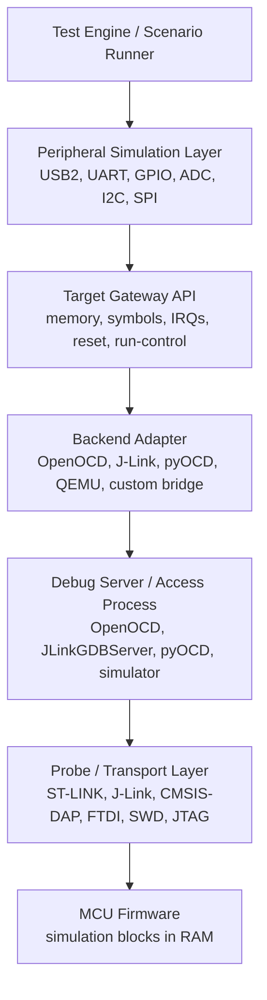
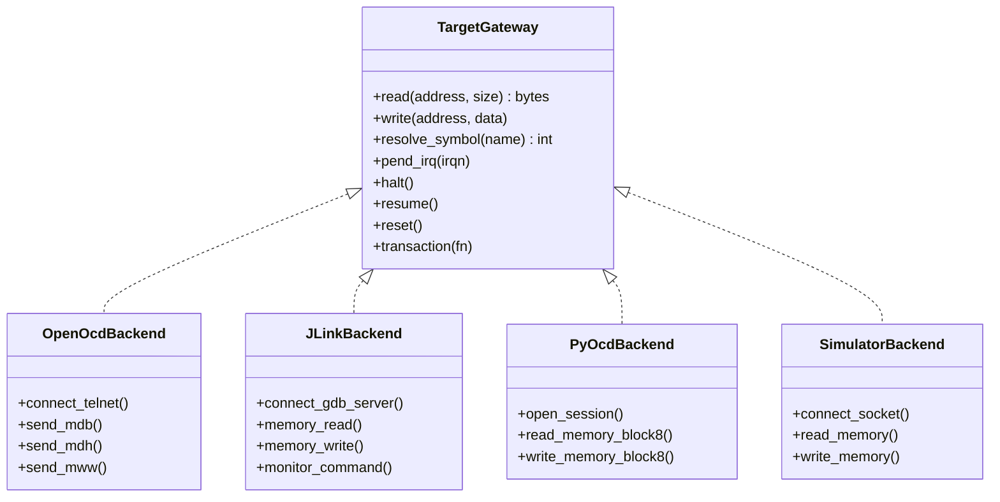
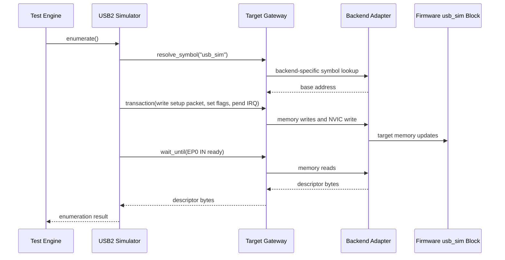

# Peripheral Simulation Backend Architecture

This document describes the architecture below the peripheral simulation layer.
The goal is to let test scenarios mock many MCU inputs and peripherals while
keeping the simulation logic independent from the debug server, probe, and
transport being used.

Peripheral simulators should express peripheral intent, such as "inject a USB
SETUP packet" or "set GPIO pin 3 high". Backend adapters should express target
mechanics, such as "write target memory", "pend an IRQ", or "resolve a symbol".

## Scope

This document focuses on the layers under the peripheral simulation layer:

- Target access API
- Backend adapters
- Debug server integration
- Probe and transport configuration
- Firmware-side simulation ABI

It does not define the full test engine API or scenario language.

## Layer Model



The important boundary is between `Peripheral Simulation Layer` and
`Target Gateway API`. A USB simulator, UART simulator, or GPIO simulator should
not know whether the current session uses OpenOCD over ST-LINK, OpenOCD over
CMSIS-DAP, J-Link GDB Server, pyOCD, or a software simulator.

## Responsibilities

| Layer | Responsibility | Should Not Know |
| --- | --- | --- |
| Test engine | Runs scenario steps and assertions | Memory layout details |
| Peripheral simulation | Converts peripheral events into firmware ABI writes and reads | Debug server protocol |
| Target gateway | Stable target operations: memory, symbols, IRQs, reset, halt/resume | Peripheral protocol details |
| Backend adapter | Implements target gateway for one access mechanism | Test scenario meaning |
| Debug server | Talks to hardware or simulator | Higher-level peripheral intent |
| Probe/transport | Physical or virtual debug connection | Test semantics |
| Firmware ABI | Versioned RAM blocks and interrupt/event contract | Host backend implementation |

## Core Abstraction

Every peripheral simulator should depend on a `TargetGateway` style interface.

```python
class TargetGateway:
    def read(self, address: int, size: int) -> bytes: ...
    def write(self, address: int, data: bytes) -> None: ...

    def read_u8(self, address: int) -> int: ...
    def write_u8(self, address: int, value: int) -> None: ...
    def read_u16(self, address: int) -> int: ...
    def write_u16(self, address: int, value: int) -> None: ...
    def read_u32(self, address: int) -> int: ...
    def write_u32(self, address: int, value: int) -> None: ...

    def resolve_symbol(self, name: str) -> int: ...

    def pend_irq(self, irqn: int) -> None: ...
    def halt(self) -> None: ...
    def resume(self) -> None: ...
    def reset(self) -> None: ...

    def wait_until(self, predicate, timeout_s: float) -> None: ...
    def transaction(self, fn) -> None: ...
```

The gateway is intentionally low level. It provides enough machinery for
peripheral simulators to drive firmware-resident simulation blocks without
binding those simulators to OpenOCD, J-Link, pyOCD, or any specific probe.

## Backend Adapter Model



OpenOCD and J-Link should be peer backend adapters. OpenOCD can itself be
configured with different adapter drivers, but that is an implementation detail
inside the OpenOCD backend configuration.

## OpenOCD Backend

The OpenOCD backend should connect to an OpenOCD server and implement
`TargetGateway` operations using OpenOCD commands.

Typical operations:

| Gateway operation | OpenOCD implementation |
| --- | --- |
| `read(address, size)` | `mdb`, `mdh`, `mdw` |
| `write(address, data)` | `mwb`, `mwh`, `mww` |
| `pend_irq(irqn)` | write NVIC ISPR |
| `halt()` | `halt` |
| `resume()` | `resume` |
| `reset()` | `reset` or `reset halt` |

Example configuration:

```yaml
backend: openocd
server:
  executable: openocd
  config: tools/link/blueUSB_stlink_swd.cfg
connection:
  telnet_host: 127.0.0.1
  telnet_port: 4444
probe:
  adapter: st-link
  transport: swd
```

Another OpenOCD configuration may use CMSIS-DAP, FTDI, or J-Link if the local
OpenOCD build supports that adapter. The peripheral simulators should not
change when this probe configuration changes.

## J-Link Backend

The J-Link backend should be separate from OpenOCD. It can use one of several
implementation strategies:

- Connect to `JLinkGDBServer` through the GDB remote protocol
- Use SEGGER's J-Link command interface
- Use a library wrapper if one is chosen for the project

Example configuration:

```yaml
backend: jlink
server:
  executable: JLinkGDBServerCLExe
  device: STM32F103C8
  interface: SWD
  speed_khz: 1000
connection:
  host: 127.0.0.1
  gdb_port: 2331
```

From the peripheral simulator's point of view, this backend still exposes the
same `TargetGateway` operations.

## Firmware Simulation ABI

To mock almost every peripheral, the host should not poke arbitrary peripheral
registers directly. Instead, the firmware should expose explicit simulation
blocks in RAM. Each block is a small ABI between the host-side simulator and the
firmware-side peripheral shim.

Recommended common header:

```c
struct sim_block_header {
    uint32_t magic;
    uint16_t version;
    uint16_t size;
    uint32_t capabilities;
    uint32_t flags;
};
```

Recommended pattern:

- Each peripheral has one exported symbol, such as `usb_sim`, `uart0_sim`, or
  `gpio_sim`.
- Each symbol points to a versioned block with a magic value.
- The host resolves the symbol, checks `magic`, `version`, and `size`, then
  drives only fields defined by that ABI.
- The host wakes firmware by pending an IRQ, setting an event flag, or using a
  firmware-defined notification mechanism.

Example USB simulation block:

```c
struct usb2_sim_block {
    struct sim_block_header header;
    uint16_t cntr;
    uint16_t istr;
    uint16_t fnr;
    uint16_t daddr;
    uint16_t btable;
    uint16_t ep_reg[8];
    uint16_t tx_pma_addr[8];
    uint16_t rx_pma_addr[8];
    uint16_t tx_count[8];
    uint8_t pma[512];
    uint8_t connected;
    uint8_t remote_wakeup;
    uint8_t device_address;
};
```

The exact fields can vary by MCU or USB implementation, but the block should be
explicit, versioned, and validated at connection time.

## Transaction Semantics

Peripheral injection often requires several target writes followed by one
notification. For example, USB OUT injection writes payload bytes, updates an
endpoint register, updates interrupt status, and then pends the USB IRQ.

The `transaction()` operation gives backends a place to make this sequence
consistent:

- Batch writes where the backend supports it.
- Optionally halt the target for sensitive multi-field updates.
- Resume or leave running according to policy.
- Fail the whole operation if a required write fails.
- Emit trace logs for reproducibility.

Peripheral simulators should keep notifications last. This prevents firmware
from observing a half-written event.

## USB2 Example



Intent-level USB API:

```python
usb.connect()
usb.reset_bus()
usb.inject_setup(packet)
usb.inject_out(endpoint=1, payload=b"test")
data = usb.read_in(endpoint=1, max_len=64)
usb.ack_in(endpoint=1)
```

Target-level implementation behind that API:

```python
gateway.write(base + layout.pma + rx_offset, payload)
gateway.write_u16(base + layout.ep_reg + ep * 2, ep_reg_with_ctr_rx)
gateway.write_u16(base + layout.istr, istr_with_ctr_and_ep)
gateway.pend_irq(USB_IRQ_NUMBER)
```

## Suggested Package Shape

```text
wcet_io_server/
  target/
    gateway.py
    symbols.py
    memory.py
    capabilities.py
  backends/
    openocd.py
    jlink.py
    pyocd.py
    simulator.py
  peripherals/
    usb2.py
    uart.py
    gpio.py
    adc.py
  firmware_abi/
    common.py
    usb2.py
    uart.py
  scenarios/
    engine.py
```

The existing USB simulator code can move toward this shape by splitting direct
target access from USB behavior:

- Keep `USBSimulator` or `Usb2Simulator` as the peripheral-facing model.
- Move pyOCD/OpenOCD/J-Link details into backend adapters.
- Replace direct backend calls with a `TargetGateway`.
- Resolve simulation block addresses through symbols when possible, with a
  configured fallback address only for early bring-up.

## Design Rules

- Peripheral simulators express intent.
- Backend adapters express mechanics.
- OpenOCD probe configuration does not leak above the OpenOCD backend.
- J-Link is a peer backend to OpenOCD, not a special case inside USB.
- Firmware simulation blocks are versioned ABI contracts.
- Notifications happen after all related memory writes.
- Capability checks happen when a session starts, not halfway through a test.
- Scenario logs should record backend type, probe, transport, target, firmware
  ABI versions, and resolved simulation block addresses.
