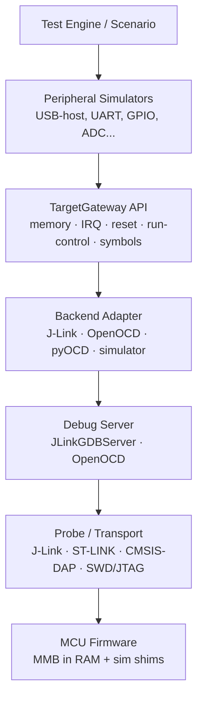
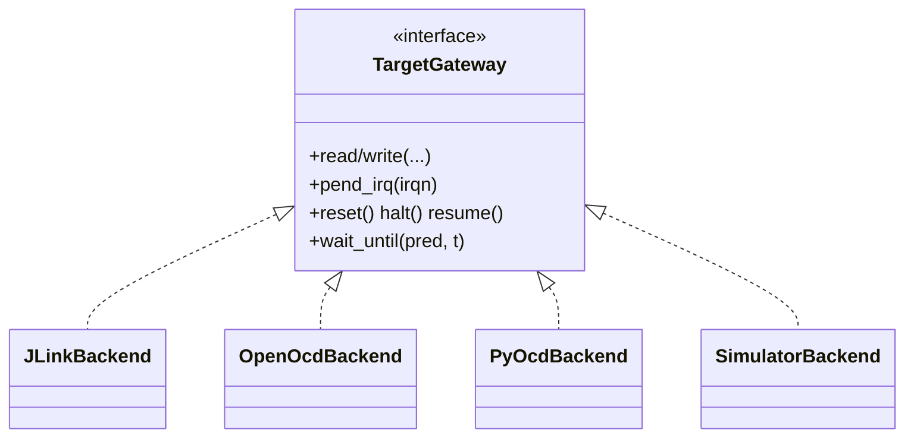
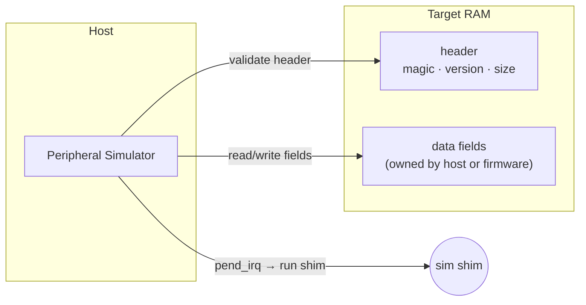
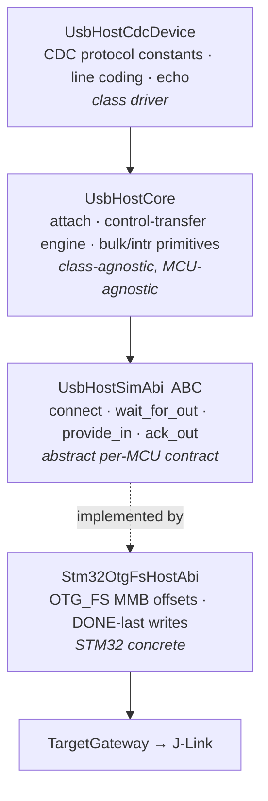
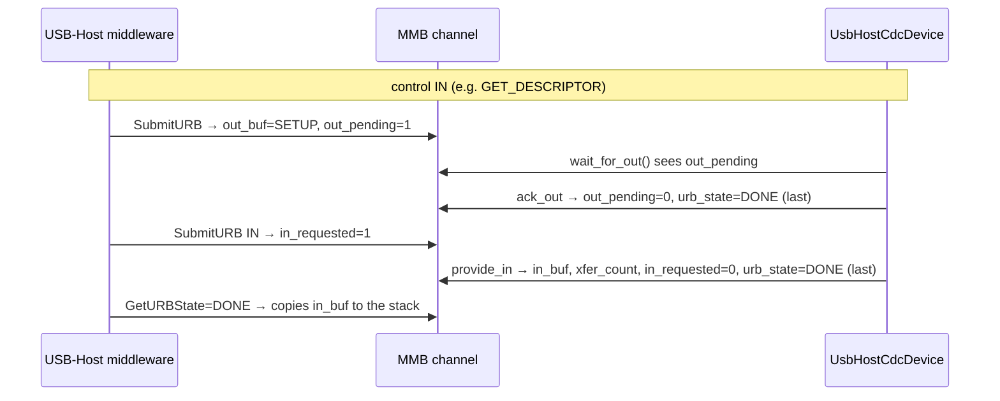
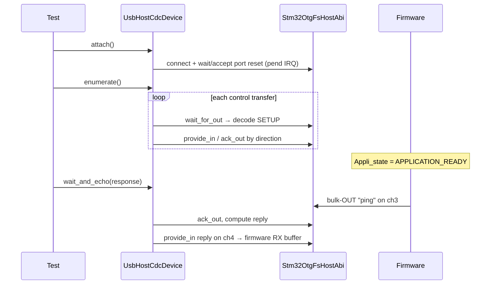

# Peripheral Simulation Backend Architecture

The IO server lets a host (tests, scenarios) **mock an MCU peripheral without the
real hardware on the other end**. The firmware runs unchanged except for thin
simulation shims that move data through a small RAM block (the *Mocking Memory
Block*, MMB) instead of a physical bus. The host drives that block over a debug
probe.

Two ideas keep this reusable across peripherals and probes:

- **Peripheral simulators express intent** — "inject a SETUP packet", "set GPIO 3 high".
- **Backends express mechanics** — "write target memory", "pend an IRQ", "reset".

Neither knows about the other: a USB simulator never learns whether the session
runs over J-Link or OpenOCD, and a backend never learns what a SETUP packet is.

## Layer model



The load-bearing boundary is **Peripheral ↔ TargetGateway**. Everything above it
is portable; everything below it is probe-specific.

| Layer | Owns | Must not know |
| --- | --- | --- |
| Peripheral simulator | Peripheral protocol → MMB reads/writes | Debug-server protocol |
| TargetGateway | Stable target ops: memory, IRQ, reset, halt/resume, symbols | Peripheral meaning |
| Backend adapter | One access mechanism behind the gateway | Test semantics |
| Firmware ABI (MMB) | Versioned RAM block + event contract | Host backend |

## TargetGateway — the one interface peripherals depend on

```python
class TargetGateway:
    def read(self, addr, size) -> bytes: ...
    def write(self, addr, data) -> None: ...
    def read_u8/u16/u32(self, addr) -> int: ...
    def write_u8/u16/u32(self, addr, value) -> None: ...
    def resolve_symbol(self, name) -> int: ...
    def pend_irq(self, irqn) -> None: ...
    def reset(self) / halt() / resume() -> None: ...
    def wait_until(self, predicate, timeout_s) -> None: ...
    def transaction(self, fn) -> None: ...
```

It is deliberately low level — just enough to drive a firmware-resident block
without binding to any probe.



This project ships the **J-Link backend** (GDB-remote to `JLinkGDBServerCLExe`).
OpenOCD/pyOCD are peers — swapping them changes config, not peripheral code.

## Firmware Simulation ABI (the MMB)

The host never pokes raw peripheral registers. The firmware instead exposes one
explicit **versioned RAM block per peripheral**, pinned at a fixed address. Each
block starts with a magic/version/size header the host validates before driving
any field. The host "wakes" the firmware by pending the peripheral IRQ.



**Notifications last.** A peripheral injection is *several writes followed by one
notification*. Always write all payload/flags first and signal completion last,
so the firmware never observes a half-written event. (The USB-host layer below
makes this rule concrete as the `urb_state = DONE`-last ordering.)

---

# USB-OTG (host) — abstract architecture

This is the first full peripheral built on the model above: the host mocks a
**USB CDC-ACM device** so the STM32 OTG_FS **USB-Host** middleware enumerates and
talks to it with no physical device attached.

**Host mode is the only USB mechanism the IO server supports.** The MCU is
always the USB host and the IO server always plays the device. There is no
device-mode mocking (MCU as device, IO server as host) — an early attempt at
it (`usb2`) was deprecated, never functional, and has been deleted. If
device-mode is ever wanted, it gets designed fresh, not derived from this
layer.

## Two orthogonal abstractions

The USB-host stack factors into a portable half and an MCU-specific half — the
same split as Peripheral/Backend, applied inside the peripheral:



- `UsbHostCore` is the generic engine: it services control transfers through a
  pluggable `responder` and wraps the bulk/interrupt primitives. A future
  MSC/HID driver subclasses it the way CDC does.
- `UsbHostCdcDevice(UsbHostCore)` adds only the CDC-specific parts. Both speak
  to hardware solely through `UsbHostSimAbi` — they would drive NXP IP3511 or
  Nordic USBD unchanged.
- `Stm32OtgFsHostAbi` is the only piece that knows the STM32 block's byte layout.

**Rule:** the generic layer (`peripherals/usb/host/abi.py`, `core.py`,
`cdc.py`) must not import `peripherals/usb/host/backends/*`, and
`peripherals/usb/common/*` must not import `peripherals/usb/host/*`. This is
enforced, not convention: `tests/test_architecture_boundaries.py` fails on any
violating import.

## The MMB: `UsbhSimBlock`

A 16-byte header plus 8 channels (one per USB pipe). Each side owns specific
fields; the other side only reads them.

```
UsbhSimBlock @ 0x2001E000          fixed top-of-RAM address (linker .mmb region)
├── header (16 B)
│   magic version block_size        ← firmware publishes (validate handshake)
│   connected port_* speed          ← host: device presence / port state
│   reset_req                       ← firmware: "please reset the port"
│   ev_connect / ev_port_en / ...   ← host sets, then pends IRQ → shim fires callback
└── ch[8]  (140 B each)             one per pipe
    ep_addr ep_type ep_dir          ← firmware: pipe identity (from OpenPipe)
    out_buf / out_len / out_pending ← firmware: a SETUP/OUT the host must service
    in_buf / xfer_count / in_requested ← host fills an IN the firmware asked for
    urb_state                       ← host: 0=IDLE 1=DONE 4=ERROR 5=STALL
```

`urb_state` is the completion signal the middleware polls. Data never moves by
IRQ — only **events** (connect / port-enable / disconnect) use the IRQ path; URB
data is poll-driven through these fields.

## Channel ↔ pipe map (CDC)

```
ch0  EP0 OUT 0x00   control SETUP/OUT     ┐ enumeration
ch1  EP0 IN  0x80   control IN            ┘
ch2  INTR IN 0x82   CDC notification      (opened, never polled)
ch3  BULK OUT 0x01  host → device         ┐ data / echo
ch4  BULK IN  0x81  device → host         ┘
```

## How a transfer flows

The middleware is the *USB host*; the IO server plays the *device*. Each URB is
a request the firmware arms in a channel and the host fulfils:



## The DONE-last ordering rule

`urb_state = DONE` unblocks the middleware's `CTRL_*_WAIT` poll, which
**immediately re-arms the next URB** on the same channel. Since every gateway
write is a separate ~ms round-trip, the host must clear the request flag
(`out_pending` / `in_requested`) and write any payload/count **before** DONE.
Reverse it and the re-armed request gets stomped, hanging the stack forever.

```
ack OUT/SETUP : out_pending=0 ; ... ; urb_state=DONE   ← DONE always last
fulfil IN     : in_buf ; xfer_count ; in_requested=0 ; urb_state=DONE
```

This is the peripheral-specific shape of the global **notifications-last** rule.

## End-to-end: enumerate → echo



`enumerate()` is a generic per-control-transfer state machine (poll EP0-OUT,
decode each SETUP, drive the data/status stage by direction), not a fixed
script — so any standard enumeration order works.

## Package shape

```text
wcet-io-server/
  target/       gateway.py  symbols.py  capabilities.py
  backends/     jlink.py  openocd.py
  firmware_abi/
    usb/host/
      stm32_otgfs.py            # MMB offsets, magic, descriptors
  peripherals/
    usb/
      common/
        requests.py             # USB 2.0 ch.9 constants -- class-agnostic
      host/
        abi.py                  # UsbHostSimAbi (ABC) -- per-MCU contract
        core.py                 # UsbHostCore -- control/bulk engine
        cdc.py                  # UsbHostCdcDevice(UsbHostCore) -- CDC driver
        backends/
          stm32_otgfs.py        # Stm32OtgFsHostAbi (concrete)
  tests/
    usb/...                     # unit tests (FakeMmbGateway, no hardware)
    hardware/usb/...            # opt-in J-Link tests (WCET_USB_HOST_TEST=1)
    support/                    # fake_gateway.py, hardware.py (shared fixture)
    test_architecture_boundaries.py  # enforces the import rules above
```

## Design rules

- Peripheral simulators express intent; backends express mechanics.
- J-Link is a peer backend, not a special case inside USB.
- The MMB is a versioned ABI: validate magic/version/size before driving fields.
- All payload/flag writes happen before the completion signal (DONE-last).
- The generic USB layers (`common/`, `abi.py`, `core.py`, `cdc.py`) never
  import a concrete backend — enforced by `tests/test_architecture_boundaries.py`.
- USB host-mode is the only supported USB mechanism; there is no device-mode
  mocking.
