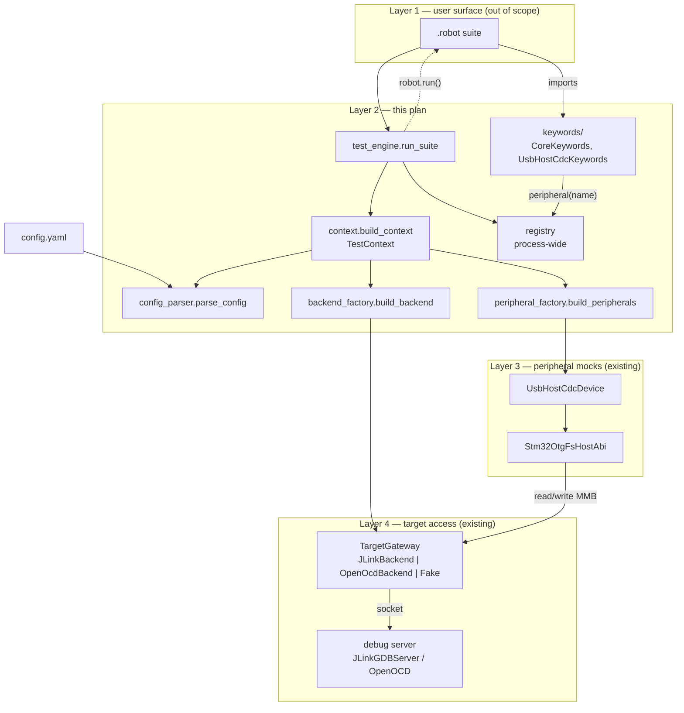
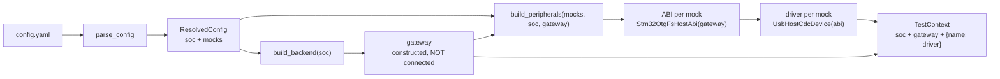
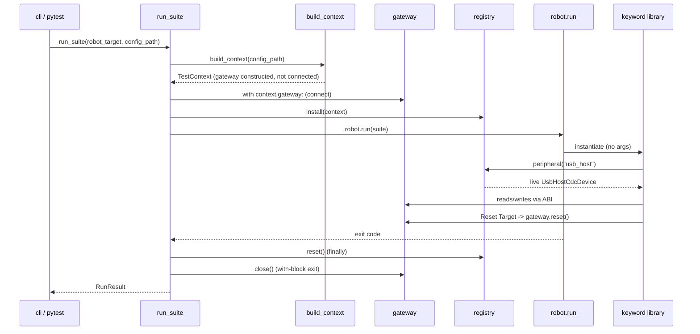
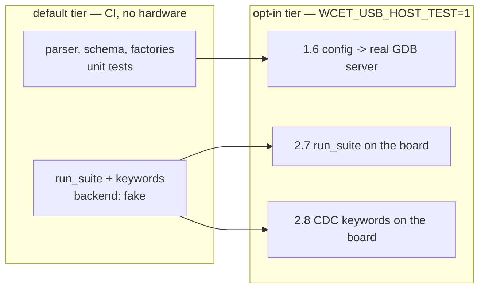

# Plan: Layer 2 — Test Engine, Config YAML, and the parser

Status: in progress — Phase 0 complete. Phases 3 and 4 are out of scope
(see Non-goals); their tasks have moved to `todo.md`. This plan now ends
at Phase 2.

Depends on [`usb-peripheral-restructure.md`](usb-peripheral-restructure.md):
Task 1.4 below resolves peripheral driver paths like
`peripherals.usb.host.cdc.UsbHostCdcDevice`, which only exist once that
plan's Phase 2 has landed. If this plan is executed first or independently,
substitute the current paths (`peripherals.usb_host.UsbHostCdcDevice`) —
the design does not otherwise depend on the restructure.

## Why

This is Layer 2 from the architecture discussion: the layer that parses a
test script and a SoC/mock config, wires up the right backend and peripheral
objects, and runs the test — sitting between Robot Framework `.robot` scripts
(Layer 1) and the existing `peripherals/` + `target/` + `backends/` stack
(Layers 3/4, unchanged by this plan).

Three pieces, matching the original architecture sketch:

- **Configuration Manager** — parses SoC + Mock List YAML into live objects.
- **Test Execution Engine** — runs a `.robot` suite against those objects and
  reports results.
- **Abstract peripheral APIs** — thin Robot Framework keyword libraries over
  the existing peripheral classes; not reimplementing them.

### Non-goals

- No CLI/CI-CD plugin at all, not even a minimal argument-parsing entry
  point — the full Layer 1 "User & API Layer" is out of scope. (An earlier
  draft of this plan scoped in a thin `engine/cli.py` as Phase 3; that task
  has moved to `todo.md` and is not built here.)
- No multi-peripheral configs at all — the MMB structure (how multiple
  peripherals share the memory-mapped block) isn't designed yet, so the
  Config Manager accepts exactly one `mocks:` entry and rejects more.
  Resolving the MMB structure, and the concurrency/locking model that
  follows from it, is tracked in `todo.md`, not here.
- No real capability model (which SoC/peripheral supports which features),
  and no capability bridge stub either — wiring an interface for a model
  that doesn't exist yet is deferred along with the model itself. (An
  earlier draft of this plan scoped in an interface-only
  `engine/capabilities_bridge.py` as Phase 4; that task has moved to
  `todo.md`.) The same gap applies to ABI resolution (Task 1.4): for now
  it's a hardcoded stub assuming every STM32 `soc.part` supports USB-host
  CDC via `Stm32OtgFsHostAbi`; the real SoC/peripheral-class → ABI
  compatibility table is a `todo.md` item, not built here.
- No Raspberry Pi HIL backend (Layer 4b) — out of scope per earlier
  discussion in this project.
- No config-driven timeouts, and no keyword/config reference docs (`libdoc`
  generation, a YAML field-reference table, an end-to-end usage note).
  These were scoped in as Phases 3 and 4 in an earlier draft of this plan;
  all of that follow-through work has moved to `todo.md`. This plan's
  scope now ends at Phase 2 (the runtime registry and Test Engine).

## Key decisions

1. **Config Manager is pure Python, zero Robot Framework dependency.** It
   must be unit-testable as "given this YAML, do I get the right objects"
   without ever invoking Robot. This is the load-bearing design constraint —
   everything in Phase 1 has no `robot` import.
2. **`robot.run()` is invoked programmatically, in-process — never shelled
   out to the `robot` CLI.** Live peripheral/gateway objects (an open J-Link
   session, a connected `TargetGateway`) can't be serialized into a `-v`
   command-line variable. The engine builds those objects, installs them in
   a runtime registry, then calls into Robot Framework's Python API directly.
3. **Keyword library instances take zero constructor arguments** and read
   live peripheral objects from the runtime registry. This is what lets
   Robot Framework construct them at parse time (before the registry is
   necessarily populated in a given call order) while still getting
   per-run, config-resolved objects.
4. **A `"fake"` backend is a first-class, explicitly-labeled option in the
   config schema**, not a hidden test hack — it's what makes every keyword
   library and Config Manager behavior testable in CI with no hardware
   attached. It must be impossible to select by accident (see Task 2.5).
5. **This repo has no dependency manifest today** — `target/`, `backends/`,
   `peripherals/`, `firmware_abi/` import nothing beyond the standard
   library. This plan is the first to need external packages (PyYAML,
   `robotframework`, `robotframework-pythonlibcore`), so establishing a
   manifest is Phase 0, not assumed.
6. **Mock config names a peripheral `class:`, never a Python import path —
   resolution to driver/ABI is a two-step lookup, and only the first step
   is real.** `class:` → driver is a fixed, SoC-independent registry (safe
   to build now: a class driver is reusable across SoCs by design).
   `soc.part` + `class:` → ABI is a genuine compatibility question this
   plan does not solve; Task 1.4 ships a hardcoded stub instead
   (`STM32* supports cdc via Stm32OtgFsHostAbi`, everything else
   `ConfigError`s) so the YAML stays abstract today without pretending a
   capability model exists. Replacing the stub with a real table is
   `todo.md`'s job.
7. **Fake-backend tests prove the wiring; hardware tests prove the
   plumbing.** The two are not substitutes. A fake gateway's `connect()`
   and `close()` are inherited no-ops, so no fake-backed test can show
   that a config's `host`/`port` reach a real GDB server, that a
   connection is actually released between runs, or that `Reset Target`
   reboots anything. Every phase therefore ends with an opt-in hardware
   task that exercises what the fake structurally cannot — see "Hardware
   verification" below. The fake tier stays the CI default; the hardware
   tier is the one that fails when the plumbing is wrong.
8. **`probe:` describes how the probe is reached, not what it is.** A
   `connection:` discriminator (`server` | `direct`) selects between two
   field sets rather than one flat bag of optionals, so the unimplemented
   mode is already representable and adding it later is a factory change,
   not a schema break. See "Probe connection shape" below.

## System shape

Three views of the same system: what the layers are, what happens when a
config is loaded, and what happens when a suite runs.

### Layers



The registry is the only path from a `.robot` suite to live objects:
keyword libraries are constructed by Robot Framework with no arguments
(Key decision 3), so they cannot be handed a peripheral — they look one up.

### Config load (Phase 1)



Nothing here touches hardware: `build_backend` only constructs the
gateway object. The socket is opened by `gateway.connect()`, which no
task currently calls — that is the open question below.

### Suite run (Phase 2)



### Connection lifecycle

`JLinkGDBServer` accepts one client at a time, so a connection that is
opened and never closed makes the *second* `run_suite()` call in the same
process fail at `connect()` with a `TargetConnectionError` that looks
like a hardware fault. `BaseTargetGateway` already provides `connect()`,
`close()`, `__enter__` and `__exit__`, so the only question was where
they are called. The decision:

- **`build_context()` never connects.** It constructs and wires objects;
  the context it returns holds an unconnected gateway. This keeps Phase 1
  hardware-free by construction rather than by discipline, so its unit
  tests need no probe and no mocking of `connect`.
- **`run_suite()` owns the connection**, wrapping the whole run in
  `with context.gateway:`. Connection lifetime is exactly suite lifetime.
- **`registry.reset()` is engine teardown, not a test action.** It is
  called by `run_suite()` in a `finally` so the process-global is cleared
  even when the suite raises, and it is never exposed as a keyword: a
  suite that cleared the registry mid-run would break every keyword after
  it, since `registry.peripheral(...)` would have nothing to look up.
- **The `Reset Target` keyword resets the device, not the engine.** It
  calls `TargetGateway.reset()`, so a suite can do work, reboot the MCU,
  and continue in the same suite. Its full name is deliberate: plain
  `Reset` reads ambiguously next to the registry's own `reset()`.

### Hardware verification

This repo already has a hardware-in-the-loop convention, and this plan
reuses it rather than inventing a second one: tests live under
`tests/hardware/`, skip themselves unless `WCET_USB_HOST_TEST=1`, and get
their bring-up from `tests/support/hardware.py` (`UsbHostHardwareTest`
connects a `JLinkBackend` from `WCET_JLINK_HOST`/`WCET_JLINK_PORT`,
resets, enables `OTG_FS_IRQn`, waits for the MMB magic). The engine's
hardware tests are `tests/hardware/engine/`, gated by the same variable,
run by the same command as the existing hardware suite.



What only the hardware tier can show:

- The `port:` → `gdb_port` / `telnet_port` mapping in `build_backend` is
  right. Fake-backed tests assert on config *objects*; a wrong mapping
  passes them and fails at the socket.
- `close()` actually releases the J-Link GDB server. `JLinkGDBServer`
  accepts one client at a time; on the fake path a leak costs nothing, so
  the run-twice test in Task 2.2 proves the *structure* and Task 2.7
  proves the *behaviour*.
- `Reset Target` reboots the device. Against the fake it records a call;
  against the board it is observable in the MMB (the magic disappears and
  `USBH_LL_Start` republishes it).
- The two-step `soc.part` + `class:` → ABI resolution produces an ABI that
  can really read the firmware's MMB, not merely an object of the right
  type.

The hardware config is not a committed fixture with hardcoded endpoints —
the board, port and firmware paths differ per machine. `tests/support/
hardware.py` gains a helper that writes a config YAML from the same
environment variables its existing bring-up already reads, so one board
setup drives both the old hardware tests and the engine's.

## Target structure

```text
engine/
  __init__.py
  config_schema.py       # SocConfig, ServerProbeConfig/DirectProbeConfig, GatewayConfig, MockConfig dataclasses
  config_parser.py         # parse_config(path) -> ResolvedConfig; validation, ConfigError
  backend_factory.py        # build_backend(soc) -> TargetGateway; "jlink" | "openocd" | "fake"
  peripheral_factory.py      # build_peripherals(mocks, soc, gateway) -> dict[str, object]
  context.py                  # TestContext, build_context(path) -- the Config Manager entry point
  registry.py                   # process-wide runtime registry: install / peripheral / gateway / reset
  test_engine.py                  # run_suite(robot_target, config_path, outdir) -> RunResult
  keywords/
    __init__.py
    core_keywords.py                # CoreKeywords -- peripheral-independent: Delay, Reset
    usb_host_cdc_keywords.py         # UsbHostCdcKeywords -- example keyword library

tests/
  engine/
    fixtures/
      minimal_fake.yaml                # single fake-backend USB host CDC mock, for parser + engine tests
    test_config_schema.py                  # constructs each dataclass, checks defaults (Task 1.1)
    test_config_parser.py
    test_backend_factory.py
    test_peripheral_factory.py
    test_context.py
    test_registry.py
    test_engine_smoke.robot               # trivial single-Log-keyword suite for Task 2.2
    test_engine_smoke.py                   # drives run_suite() against it
    test_core_keywords.robot                # exercises Delay/Reset with zero mocks configured
    test_core_keywords.py
    test_usb_host_cdc_keywords.robot        # exercises the example keyword library end-to-end (fake backend)
    test_usb_host_cdc_keywords.py
  hardware/
    engine/                                  # opt-in HIL tier, WCET_USB_HOST_TEST=1
      __init__.py
      test_backend_factory.py                 # config endpoint -> real GDB server; connect/close/reconnect (1.6)
      test_context.py                          # build_context on the board reads the real MMB magic (1.6)
      test_run_suite.py                         # run_suite on the board, twice in one process, Reset Target (2.7)
      test_cdc_keywords.robot                    # the four CDC keywords against real firmware (2.8)
      test_cdc_keywords.py
  support/
    hardware.py                                   # existing; gains hil_config_yaml() (Task 1.6)
```

## Config YAML shape (target for Phase 1)

```yaml
soc:
  part: STM32F407VG
  backend: jlink            # jlink | openocd | fake
  probe:                    # optional; omitted = server on backend defaults
    connection: server      # server | direct (direct: parses, not implemented)
    host: 127.0.0.1         # server only
    port: 2331              # server only; defaults per backend
    timeout_s: 2.0          # optional, both modes
  gateway:
    mmb_base: 0x2001E000
  timeouts:                 # optional; Task 4.1
    default_s: 3.0

mocks:
  - name: usb_host
    class: cdc
    channels: 8
    device:
      vid: 0x0483
      pid: 0x5740
```

`class` names the peripheral abstractly — never a Python import path.
`peripheral_factory` resolves it in two steps:

1. `class:` → driver class, via a fixed `{"cdc": UsbHostCdcDevice, ...}`
   registry. SoC-independent: a class driver is reusable across SoCs by
   design, so this mapping never depends on `soc.part`.
2. `soc.part` + `class:` → ABI implementation. **This step is a stub, not
   a capability model.** For now it assumes every STM32 `soc.part`
   supports the USB-host CDC peripheral and always resolves to
   `Stm32OtgFsHostAbi`, raising `ConfigError` for any non-STM32 `soc.part`
   or any `class:` other than `cdc`. The real per-part compatibility
   table is a `todo.md` item — see Key decision 6 and the Non-goals
   section above.

`device:` is optional per-mock identity data the class driver presents
during enumeration (VID/PID today; descriptors and line-coding defaults
later) — kept as data, not arguments to a keyword, so it can vary per
config without touching `.robot` scripts.

### Probe connection shape

A probe is reachable two ways, and which one is in use decides which
fields mean anything — so `connection:` is an explicit discriminator, not
something inferred from which optional keys happen to be present:

- `connection: server` (the only implemented mode) — the backend is a
  client of an already-running `JLinkGDBServer` or OpenOCD daemon, reached
  at `host:port`. This is what `backends/` does today: both gateways open
  a socket and speak GDB-remote or telnet.
- `connection: direct` — the backend drives the probe over USB itself
  (and would then need `serial:` to pick among attached probes). Not
  implemented; `build_backend` raises `NotImplementedError` for it, the
  same treatment unknown backend names get. Tracked in `todo.md`.

`serial:` is rejected under `server` and `host:`/`port:` under `direct`,
each with a specific `ConfigError` — a field that cannot affect the
connection is a parse failure, never a silent no-op. Probe selection by
serial is meaningless in server mode because it happens one layer below
the socket, at server-launch time (`JLinkGDBServer -select USB=<serial>`,
or `adapter serial` in an OpenOCD config), and nothing in this repo
launches either server.

`port:` has no schema-level default: J-Link's GDB server listens on 2331,
OpenOCD's telnet on 4444, so any single default would bake one backend's
number into a backend-agnostic layer. Left unset it stays `None` and
`build_backend` falls through to `JLinkConnectionConfig` /
`OpenOcdConnectionConfig`, which already carry the right values.

### USB CDC device-mock keyword design

Despite the `usb_host` naming, `UsbHostCdcDevice` mocks the *device* side
(CDC-ACM) presented to the target's USB-host middleware — "host" describes
the target's role, not the mock's. This is the design worked out for its
keyword library, and the pattern future device classes (HID, MSC, ...)
should follow:

- **One keyword library per device class, never a generic USB library.**
  `UsbHostCdcKeywords` is what a `.robot` suite imports; USB itself is
  never a directly-importable Robot Framework library, only the
  driver/ABI resolution triggered by the `class:` field in the YAML
  config. A future HID mock gets its
  own `usb_host_hid_keywords.py`, not a shared "USB" library — the class
  is more abstract than the transport, from the keyword surface's point
  of view.
- **Four keywords, no more:** `Attach Device`, `Detach Device`,
  `Send Packet`, `Receive Packet`. Attach/Detach are external lifecycle
  events (plugging/unplugging the mock); Send/Receive are the two things
  a normal CDC application does (`bulk_in`/`bulk_out` under the hood).
- **Enumeration is not a keyword.** It isn't an independent event from
  the application's point of view — it's a mandatory, automatic
  consequence of attaching. `Attach Device` runs `UsbHostCore.attach()`
  (physical connect + port reset) and `UsbHostCdcDevice.enumerate()`
  (the SET_ADDRESS/GET_DESCRIPTOR/SET_CONFIGURATION control-transfer
  sequence) back to back; by the time the keyword returns, the mock is
  host-configured and ready for traffic. Same reasoning applies to CDC
  line-coding negotiation (GET/SET_LINE_CODING): it's a control transfer
  the host driver issues automatically, not application logic, so its
  default value is config data (alongside VID/PID above), never a
  keyword.
- **No dedicated assertion keyword.** `Receive Packet` returns the bytes
  it read; a test verifies them with Robot's own `Should Be Equal`
  rather than a peripheral-specific "verify" keyword.

## Tasks

### Phase 0 — scaffold

- [x] **0.1 — Establish a dependency manifest.** Add `pyproject.toml` (or
      `requirements.txt`, whichever matches how the project is actually
      run today — check before choosing) declaring `PyYAML`,
      `robotframework`, and `robotframework-pythonlibcore`. First
      dependencies this repo has ever declared; call that out in the PR/commit
      description so it isn't a surprise.
      Verify: a clean virtualenv install from the manifest succeeds; existing
      tests (which need none of these) still pass without it.
- [x] **0.2 — Create the `engine/` package** (flat, top-level — matching
      `target/`, `backends/`, `peripherals/` convention, not nested under a
      namespace package). Empty `__init__.py`, no logic yet.
      Verify: `import engine` works from repo root.
- [x] **0.3 — Write the config schema + example fixtures before the parser.**
      Commit `tests/engine/fixtures/minimal_fake.yaml` (shape above, using
      `backend: fake`). No parser code yet — it is the target the parser is
      built against.
      Verify: the fixture is valid YAML (`python -c "import yaml; yaml.safe_load(open(...))"`).

### Phase 1 — Config Manager

- [x] **1.1 — `engine/config_schema.py`.** Dataclasses for `SocConfig`,
      `ServerProbeConfig`, `DirectProbeConfig`, `GatewayConfig`,
      `MockConfig`, `TimeoutConfig`. `ProbeConfig` is the union alias of
      the two probe forms — see "Probe connection shape" above.
      `MockConfig` carries `peripheral_class` (parsed from the YAML
      `class:` key — `class` is a Python keyword, so the dataclass field
      is named differently) and an optional nested `device` mapping (e.g.
      CDC's `vid`/`pid`) — untyped/passthrough at this layer so each
      driver defines its own device-identity fields without schema
      changes; see "USB CDC device-mock keyword design" above. No
      `driver`/`abi` fields — those are resolved, not configured (Task
      1.4). Pure data, no parsing or I/O.
      Verify: unit test constructs each dataclass directly, checks defaults.
- [x] **1.2 — `engine/config_parser.py`: `parse_config(path) -> ResolvedConfig`.**
      Loads YAML, validates required fields, raises `ConfigError` with a
      specific message for each failure mode (missing `soc:`, unknown
      `backend:`, empty `mocks:`, more than one `mocks:` entry (the MMB
      structure for multiple peripherals isn't designed yet — see
      `todo.md`), unknown `class:`, unknown `probe.connection:`, and a
      probe field belonging to the other connection mode).
      Verify: table-driven tests — one passing case against
      `minimal_fake.yaml`, one test per failure mode above, each asserting
      the specific `ConfigError` message.
- [x] **1.3 — `engine/backend_factory.py`: `build_backend(soc) -> TargetGateway`.**
      Registry mapping `backend: "jlink"` → `JLinkBackend(...)`,
      `"openocd"` → `OpenOcdBackend(...)`. Unknown backend name (including
      `"pyocd"`, `"renode"` — not implemented yet) raises `NotImplementedError`
      with a message naming what's missing, not a silent no-op.
      Verify: unit test with a monkeypatched backend constructor (no real
      probe connection) asserts the right class is selected per config.
      - [x] **1.3a — thread `probe:` into the connection configs.** A
            `server` probe's `host`/`port`/`timeout_s` populate
            `JLinkConnectionConfig` / `OpenOcdConnectionConfig`, each
            unset field falling through to that backend's own default;
            `connection: direct` raises `NotImplementedError`. Construction
            only — still no `connect()` call.
            Verify: unit test asserts a config naming a non-default host
            and port reaches the gateway's connection config, that an
            absent `probe:` leaves backend defaults intact, and that a
            `direct` probe raises.
- [x] **1.4 — `engine/peripheral_factory.py`: `build_peripherals(mocks, soc, gateway) -> dict[str, object]`.**
      Two-step resolution per mock: (a) `peripheral_class` → driver class
      via a fixed `{class_name: driver_path}` registry, resolved via
      `importlib` — SoC-independent; (b) `soc.part` + `peripheral_class` →
      ABI implementation. Step (b) is a stub for this plan, not a
      capability model: it assumes every STM32 `soc.part` supports the
      peripheral and always resolves `cdc` to `Stm32OtgFsHostAbi`, raising
      `ConfigError` for any other class or non-STM32 part. Constructs the
      ABI against the gateway, then the driver against the ABI, keyed by
      `name:`. Real per-part compatibility data replaces this stub later —
      tracked in `todo.md`, not this task.
      Verify: unit test with a fake gateway and the `minimal_fake.yaml`
      fixture (using `class: cdc`) asserts `build_peripherals(...)["usb_host"]`
      is the expected type and its `.abi` is wired to the fake gateway; a
      second test asserts a non-STM32 `soc.part` or unknown `class:` raises
      `ConfigError`.
- [x] **1.5 — `engine/context.py`: `TestContext` + `build_context(path) -> TestContext`.**
      Ties 1.1–1.4 together as the single Config Manager entry point.
      Construction only: the gateway it carries is **not connected** —
      opening and closing it belongs to `run_suite` (Task 2.2), see
      "Connection lifecycle" above. That is what keeps this task's test
      hardware-free without mocking `connect()`.
      Verify: end-to-end unit test, `minimal_fake.yaml` in, a `TestContext`
      out with a working fake-backed peripheral — zero RF, zero real
      hardware. `backend_factory.build_backend` doesn't implement `"fake"`
      until Task 2.5, so the test monkeypatches `build_context`'s
      `build_backend` to return a `FakeMmbGateway` regardless of
      `soc.backend`, letting `build_context(path)` itself run end-to-end
      against the real parser and peripheral factory.
- [x] **1.6 — Hardware verification of the Config Manager.** The first
      time this plan's code touches a real target. Add
      `hil_config_yaml(tmp_path, **overrides)` to `tests/support/hardware.py`:
      writes a config YAML with `backend: jlink`, `part` and `probe:`
      taken from the same `WCET_JLINK_HOST`/`WCET_JLINK_PORT`/
      `WCET_JLINK_TIMEOUT` variables the existing bring-up reads, so one
      board setup serves both suites. Then two hardware tests, skipped
      unless `WCET_USB_HOST_TEST=1`:
      `tests/hardware/engine/test_backend_factory.py` — `build_backend`
      on that config, `connect()`, read a known address, `close()`, then
      connect a second time and succeed (proving both the endpoint
      mapping and that `close()` releases the single-client GDB server);
      and `tests/hardware/engine/test_context.py` — `build_context` on
      the same config, connect its gateway, and read the MMB magic
      through `context.peripherals["usb_host"].abi`, proving the
      `soc.part` + `class:` → ABI resolution produced something that can
      really talk to the firmware.
      Verify: both pass with the board attached and `JLinkGDBServer`
      running; both skip cleanly with the env var unset.
### Phase 2 — runtime registry + Test Engine

- [x] **2.1 — `engine/registry.py`.** `install(context)`, `peripheral(name)`,
      `gateway()`, `reset()`. Process-wide, minimal — no threading concerns
      yet (single active suite at a time). `reset()` is engine teardown
      called by `run_suite`, never reachable from a suite — see
      "Connection lifecycle" above.
      Verify: unit test installs a fake context, checks lookups, checks
      `reset()` clears it (needed so successive test-engine runs in the same
      process/pytest session don't leak state between them).
- [x] **2.2 — `engine/test_engine.py`: `run_suite(robot_target, config_path, outdir="results") -> RunResult`.**
      `build_context` → `with context.gateway:` → `registry.install` →
      `robot.run(robot_target, outputdir=outdir)`, with `registry.reset()`
      in a `finally`. This function owns the connection for the whole run;
      nothing above or below it opens or closes the gateway — see
      "Connection lifecycle" above.
      Verify against `tests/engine/test_engine_smoke.robot` — a single
      suite with one `Log` keyword and no peripheral dependency — proving
      the plumbing works before any keyword-library complexity is added.
      A second test calls `run_suite()` twice in one process against the
      same config and asserts both pass, proving the connection and the
      registry are released between runs.
- [x] **2.3 — General keyword library: `engine/keywords/core_keywords.py`.**
      `CoreKeywords`, always loaded regardless of what's in
      `mocks:` — the peripheral-independent tier from the keyword-protocol
      discussion (as opposed to per-class libraries like
      `UsbHostCdcKeywords`). Exposes `Delay` (thin wrapper over
      `time.sleep`, touches no registry state) and `Reset Target` (reboots
      the device under test via `registry.gateway().reset()`, so a suite
      can do work, reset, and continue). It does **not** expose
      `registry.reset()` — that is engine teardown owned by `run_suite`,
      see "Connection lifecycle" above. Independent of Task 2.4 — neither
      needs a mock configured or a specific peripheral driver.
      Verify: `tests/engine/test_core_keywords.robot` calls `Delay` and
      `Reset Target` through `run_suite()` against `minimal_fake.yaml`,
      passes, and keeps working after the reset — a keyword call following
      `Reset Target` still resolves against the registry.
      The mock it declares is irrelevant to these keywords — the config
      carries one only because a config with zero mocks is invalid (Task
      1.2), not because the test needs a peripheral.
- [x] **2.4 — Example keyword library: `engine/keywords/usb_host_cdc_keywords.py`.**
      `UsbHostCdcKeywords` wrapping
      `peripherals.usb.host.cdc.UsbHostCdcDevice`, reading from
      `registry.peripheral("usb_host")`. Exposes exactly `Attach Device`,
      `Detach Device`, `Send Packet`, `Receive Packet` — per "USB CDC
      device-mock keyword design" above. No `Enumerate Device` keyword:
      `Attach Device` runs `attach()` + `enumerate()` internally.
      Verify: `tests/engine/test_usb_host_cdc_keywords.robot` runs these
      four keywords through `run_suite()` against a `backend: fake` config
      whose `usb_host` peripheral is a recording double, and passes. The
      subject is the keyword surface — name resolution, the registry
      lookup, argument and return-value conversion, and which driver calls
      each keyword makes in what order — not the driver itself: against a
      bare `FakeMmbGateway` nothing plays the target's side, so a real
      `attach()`/`enumerate()` can only time out. Driver behaviour is
      covered by `tests/usb/host/` and the hardware tier.
- [x] **2.5 — Add the `"fake"` backend to `backend_factory.py`.** Constructs
      the shared `FakeMmbGateway` test double (from the restructure plan's
      Task 4.2) instead of a real probe. Gate it behind an explicit
      `WCET_ALLOW_FAKE_BACKEND=1` environment check in `build_backend`, so a
      config typo can never silently run a "test" against nothing.
      Also give `FakeMmbGateway` a `reset()` that records the call instead
      of inheriting `BaseTargetGateway`'s "backend does not implement
      reset" error — otherwise Task 2.3's `Reset Target` cannot be tested
      on the fake path at all.
      Verify: `minimal_fake.yaml` works with the env var set; a unit test
      asserts `build_backend` raises without it; a third asserts
      `FakeMmbGateway.reset()` records the call rather than raising.
- [x] **2.6 — `RunResult` dataclass.** `run_suite()` returns pass/fail
      counts and the `output.xml`/`log.html`/`report.html` paths instead of
      just Robot's raw exit code, so a future Layer 1 CLI has something
      structured to consume.
      Verify: unit test against the Task 2.2 smoke suite checks the
      returned counts and that the artifact paths exist on disk.
- [ ] **2.7 — Hardware verification of the Test Engine.**
      `tests/hardware/engine/test_run_suite.py`, on the Task 1.6 config:
      run the smoke suite through `run_suite()` against the board; run it
      twice in the same process and assert both pass (the fake-backed
      version of this in Task 2.2 cannot fail, since a leaked fake
      connection costs nothing — here a leak means the second
      `connect()` is refused); and run a suite calling `Reset Target`,
      asserting the reboot is observable in the MMB rather than merely
      recorded, by watching the magic disappear and `USBH_LL_Start`
      republish it.
      Verify: all three pass with hardware attached; skip cleanly without.
- [ ] **2.8 — Hardware verification of the CDC keyword library.**
      `tests/hardware/engine/test_cdc_keywords.robot` driven from
      `test_cdc_keywords.py`: `Attach Device`, `Send Packet`,
      `Receive Packet`, `Detach Device` against the real firmware's host
      stack — the same ground `tests/hardware/usb/host/test_cdc_echo.py`
      covers today, but reached through the config → registry → keyword
      path instead of direct construction. This is what proves the whole
      Layer 1→4 stack works on hardware, not just each layer's seam.
      Verify: the suite passes against a board running the
      `-DUSB_HOST_SIMULATION` firmware; skips cleanly without.

### Out of scope — Phases 3 and 4

An earlier draft of this plan continued past Phase 2 with a Phase 3 (CLI
entry point, usage docs, `libdoc` keyword reference, YAML config reference)
and a Phase 4 (config-driven timeouts, capability bridge stub). Both are
out of scope for this plan — see "Non-goals" above. The individual tasks
they contained (`engine/cli.py`, the usage note, `libdoc` generation, the
YAML field-reference table, config-driven timeouts, and the capability
bridge stub) are tracked as follow-on work in `todo.md` instead, to be
picked up as their own plan once Phase 2 lands.

## Order

Phase 0 before everything. Within Phase 1, tasks 1.1–1.5 are sequential
(each depends on the previous); 1.6 needs all of them and a board, and is
the gate on starting Phase 2 — a Config Manager that has never reached
real silicon is not finished, and every later hardware failure would
otherwise have two candidate causes instead of one.
Phase 2 needs all of Phase 1. Task 2.3 (general keywords) is independent
of 2.4 (CDC keywords) — either can be built first, or in parallel — but
because its config must declare a mock, it also needs 2.5 (the `fake`
backend) before it can run. Tasks 2.7 and 2.8 close Phase 2 (2.7 needs
2.2/2.3, 2.8 needs 2.4) and both need 1.6's config helper. Phase 2 is the
end of this plan's scope — see "Out of scope — Phases 3 and 4" above.
